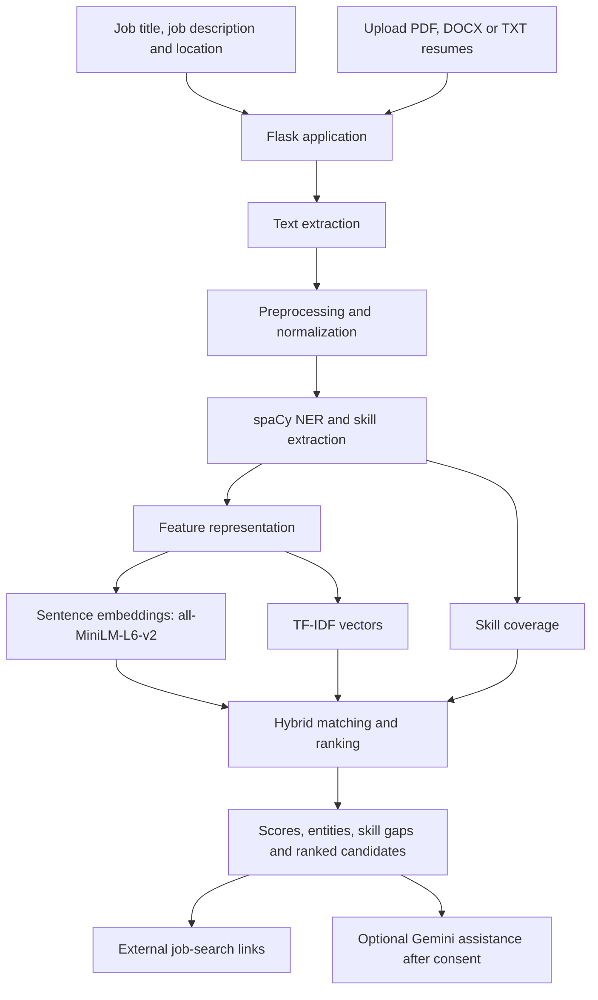

<h1 align="center">Intelligent Resume–Job Matching System</h1>

<p align="center">
  <strong>An Explainable NLP Framework for Semantic Resume Screening, Candidate Ranking and Skill-Gap Analysis</strong>
</p>

<p align="center">
  <a href="https://github.com/Suyash-Hadole/NLP-Resume-Job-Matcher">GitHub Repository</a>
  · Python · Flask · spaCy · Sentence Transformers · scikit-learn · Gemini API
</p>

---
<div align="center">
  
</div>


## Overview

The **Intelligent Resume–Job Matching System** is an NLP-based web application that analyzes resumes against a job description and produces an explainable relevance report. Instead of relying only on exact keyword matches, it combines **Named Entity Recognition (NER), technical-skill extraction, sentence embeddings, TF-IDF and cosine similarity** to compare candidate profiles with job requirements.

Users can upload one or more resumes, select a sample role or enter a custom job description, review matching and missing skills, compare candidates, and follow external job-search links for the selected role and location. An optional Gemini-powered assistant can provide contextual explanations and resume guidance after the user gives consent.

The project also includes independent Jupyter Notebook exercises for sentiment analysis and topic modelling to demonstrate additional NLP concepts required by the academic assessment.

## Project Poster

The A4 project poster is included in this repository as [`img.png`](img.png).

## Key Features

### Resume–job matching

- Accepts PDF, DOCX and TXT resumes.
- Supports multiple-resume comparison against one job description.
- Supports sample job descriptions and user-provided job descriptions.
- Extracts resume text and provides validation for unsupported, empty or unreadable documents.
- Produces semantic similarity, TF-IDF and skill-coverage scores.
- Ranks candidates using a configurable hybrid scoring model.

### NLP and information extraction

- Text cleaning and preprocessing before comparison.
- spaCy-based Named Entity Recognition (NER).
- Pattern-based extraction of contact information and other resume fields.
- Technical-skill extraction and normalization against a skill vocabulary.
- Extraction of information such as names, organizations, dates, education, experience, email addresses, phone numbers and links where detectable.
- Skill-gap analysis showing matched, missing, additional and related skills.

### Explainable matching

The matching report is designed to show more than a single score. It provides the underlying score components, extracted information, matched skills, missing requirements and candidate ranking. Similarity scores indicate textual relevance to a job description; they are **not** probabilities of being hired.

### Job-search links

The application can construct external job-search links from the entered job title and preferred location for platforms such as:

- LinkedIn Jobs
- Indeed India
- Naukri.com
- Glassdoor
- Wellfound

These links open the relevant platform's search page. They are external search links, not verified individual vacancies or direct application links supplied by this application.

### Academic NLP notebooks

The following exercises are maintained separately from the main matching dashboard:

- **Sentiment Analysis:** VADER-based sentiment classification with evaluation outputs such as accuracy, precision, recall, F1-score and a confusion matrix.
- **Topic Modelling:** Latent Dirichlet Allocation (LDA) using scikit-learn, with topic keywords and document-topic distributions.

Notebook results should be interpreted with respect to the dataset used. A small or synthetic dataset is suitable for a classroom demonstration but does not establish general real-world performance.

### Optional Gemini AI Career Assistant

When configured, the Google Gemini API can support tasks such as:

1. Explaining the resume–job match using the local analysis results.
2. Suggesting resume improvements related to identified skill gaps.
3. Rewriting existing resume bullet points more clearly without inventing experience or qualifications.
4. Generating role-specific interview preparation questions.

Gemini is optional. Local resume parsing and matching should remain available without a Gemini API key. Cloud requests require explicit user consent; only the intended, redacted context should be sent. AI-generated suggestions must be reviewed by the user and do not alter the locally calculated matching scores.

## How It Works



## Hybrid Scoring Model

The poster describes the following hybrid weighting. The implementation should use the same weights and normalization rules as the scoring code in the repository.

| Component | Weight | Purpose |
|---|---:|---|
| Semantic similarity | 50% | Compares resume and job-description meaning using sentence embeddings and cosine similarity. |
| Skill coverage | 35% | Measures the proportion of recognized job skills found in the resume. |
| TF-IDF similarity | 15% | Provides a lexical similarity baseline using TF-IDF vectors. |

The combined score is:

\[
S_{final}=0.50S_{semantic}+0.35S_{skills}+0.15S_{TF-IDF}
\]

All components must be normalized to the same 0–100 scale before they are combined. If the implementation changes its weights or normalization method, update this section to match the code. The score is a project-specific relevance indicator, not a hiring probability.

## Technology Stack

| Layer | Technologies | Purpose |
|---|---|---|
| Programming language | Python | Backend and NLP processing |
| Web backend | Flask | Web application and API routes |
| Frontend | HTML, CSS, JavaScript | Interactive dashboard |
| Document parsing | pypdf, python-docx | PDF and DOCX text extraction |
| NLP / NER | spaCy | Preprocessing and named-entity recognition |
| Sentence embeddings | Sentence Transformers, `all-MiniLM-L6-v2` | Semantic representation of text |
| Vectorization and similarity | scikit-learn, TF-IDF, cosine similarity | Lexical baseline and similarity calculations |
| Numerical processing | NumPy | Vector and numerical operations |
| Sentiment analysis | VADER | Positive, negative and neutral sentiment analysis in the notebook |
| Topic modelling | scikit-learn LDA | Discovering topics in a document collection |
| Cloud generative AI | Google Gemini API, `google-genai` | Optional AI assistance |
| Testing | pytest | Automated testing |

## Project Structure

The main application is located in the `resume-job-matcher/` directory of this repository.

```text
resume-job-matcher/
├── app.py
├── requirements.txt
├── README.md
├── img.png
├── nlp/
│   ├── __init__.py
│   ├── resume_parser.py
│   ├── preprocessing.py
│   ├── ner_extractor.py
│   ├── embeddings.py
│   ├── semantic_matcher.py
│   └── skill_gap.py
├── data/
│   ├── skills.json
│   └── sample_jobs.json
├── templates/
│   └── index.html
├── static/
│   ├── css/
│   │   └── style.css
│   └── js/
│       └── main.js
├── notebooks/
│   ├── sentiment_analysis.ipynb
│   └── topic_modelling.ipynb
└── tests/
    └── test_matcher.py
```

Additional configuration and integration files may be present in the current version. Keep this structure synchronized with the actual repository if files are renamed or added.

## Getting Started

### Prerequisites

- Python 3.10 or later (Python 3.10–3.12 is a practical range for many NLP package combinations).
- Git (optional, for cloning the repository).
- Internet access for initial package installation and first-time model downloads.

### 1. Clone the repository

```bash
git clone https://github.com/Suyash-Hadole/NLP-Resume-Job-Matcher.git
cd NLP-Resume-Job-Matcher/resume-job-matcher
```

If you have already downloaded the project, open the `resume-job-matcher` directory in your terminal instead.

### 2. Create and activate a virtual environment

**Windows PowerShell:**

```powershell
python -m venv .venv
.\.venv\Scripts\Activate.ps1
```

If PowerShell blocks activation, run this for the current terminal session and activate again:

```powershell
Set-ExecutionPolicy -Scope Process -ExecutionPolicy Bypass
.\.venv\Scripts\Activate.ps1
```

**macOS / Linux:**

```bash
python3 -m venv .venv
source .venv/bin/activate
```

### 3. Install dependencies

```bash
python -m pip install --upgrade pip
python -m pip install -r requirements.txt
```

### 4. Install the spaCy English model

```bash
python -m spacy download en_core_web_sm
```

Verify the model:

```bash
python -c "import spacy; nlp=spacy.load('en_core_web_sm'); print('spaCy NER model ready:', nlp.pipe_names)"
```

### 5. Start the application

```bash
python app.py
```

Open the local address printed by Flask. The default development address for the original application is:

```text
http://127.0.0.1:5000
```

Keep the terminal open while using the application. Press `Ctrl+C` to stop the development server.

## Model Downloads

The sentence-transformer model `all-MiniLM-L6-v2` may be downloaded from Hugging Face on first use and cached on the machine. The first model load can take longer than subsequent runs. An internet connection is normally required for the initial download unless the model is already cached or supplied locally.

If the embedding model cannot be loaded, check the application status and logs. If a fallback is provided by the application, the interface should clearly identify it; do not interpret a TF-IDF fallback score as a sentence-transformer embedding score.

## Gemini Configuration (Optional)

The local NLP workflow does not require Gemini. To enable the optional AI Career Assistant:

1. Create an API key in [Google AI Studio](https://aistudio.google.com/app/apikey).
2. Configure the key as an environment variable on the machine or deployment platform.
3. Configure the model identifier supported by your Gemini API account and application code.
4. Restart or redeploy the application after changing environment variables.

Example `.env` file for local development:

```env
GEMINI_API_KEY=your_gemini_api_key
GEMINI_MODEL=your_supported_gemini_model
```

Do not commit `.env` to Git or expose the API key in frontend JavaScript, screenshots or public logs. Use `.env.example` with placeholder values only. Confirm that the Gemini SDK and model identifier in the code match the current Google Gen AI SDK documentation.

## Using the Application

1. Open the dashboard.
2. Enter or select a job title and job description.
3. Enter the preferred job location if job-search links are required.
4. Upload one or more supported resume files.
5. Start the analysis.
6. Review candidate rankings, semantic and lexical scores, extracted entities, matched skills and missing skills.
7. Use the external job-search links to open relevant role-and-location searches on recruitment platforms.
8. Optionally provide consent and select a Gemini task to request AI-generated guidance.

Review extracted information and AI-generated suggestions before using them. The system is decision support and should not be used as an automatic hiring decision-maker.

## Sentiment Analysis and Topic Modelling Notebooks

Open the notebooks in Jupyter:

```bash
python -m pip install notebook jupyterlab
jupyter lab
```

Then open:

- `notebooks/sentiment_analysis.ipynb`
- `notebooks/topic_modelling.ipynb`

Run the cells in order to reproduce preprocessing, model execution, charts and evaluation outputs. If the notebooks use additional packages not listed in `requirements.txt`, add those actual dependencies to the requirements file and document them here.

## API Endpoints

The original Flask application provides the following core endpoints. Check `app.py` for the latest request fields and response schema before integrating another client.

| Method | Endpoint | Purpose |
|---|---|---|
| GET | `/` | Main dashboard |
| GET | `/api/health` | Backend and model status |
| GET | `/api/jobs` | Sample job descriptions |
| POST | `/api/match` | Analyze and rank uploaded resumes against a job description |

The matching endpoint uses multipart form data for resume files and job details. Example for a local server:

```powershell
curl.exe -X POST http://127.0.0.1:5000/api/match `
  -F job_id=python-developer `
  -F "resumes=@C:\path\to\resume.pdf"
```

## Testing

Run the automated test suite from the project directory:

```bash
python -m pytest -v
```

Tests should be run in the same virtual environment used by the application. Some tests that require a real downloaded embedding model may need internet access or a pre-cached model. Report the test result from the latest actual test run; do not rely on historical pass counts.

## Privacy and Responsible Use

- Resume content can contain personal and sensitive information. Handle uploaded documents carefully.
- Local parsing and matching should be performed locally where supported by the configured deployment.
- Gemini requests are external cloud requests. Send resume context only after explicit user consent and apply the application's redaction and data-minimization steps.
- Do not put API keys or private resumes in the public repository.
- Similarity and skill-coverage scores are not hiring probabilities and should not be the sole basis for recruitment decisions.
- Review extracted entities and skills because document layouts, abbreviations and parsing quality can affect results.
- External job-search links open third-party sites; their listings, terms and availability are controlled by those sites.

## Limitations

- Image-only or scanned PDFs require OCR; text extraction alone may not read them.
- Resume formatting and multi-column layouts can affect text extraction.
- NER and skill extraction may miss uncommon names, qualifications, abbreviations or domain-specific skills.
- Skill matching depends on the coverage and aliases in the skill vocabulary.
- Sentence-embedding and TF-IDF scores are similarity indicators and require validation on representative resume–job pairs before being used for high-stakes decisions.
- Gemini requires a valid API key, model access, quota and network connectivity.
- The full NLP dependency stack may exceed serverless function packaging limits. Verify the target platform's bundle, memory, execution-time and temporary-storage constraints. If necessary, host the Flask/NLP inference service separately and deploy only a lightweight frontend to a serverless platform.

## Future Enhancements

- OCR support for scanned resumes.
- Multilingual resume parsing and matching.
- Larger manually labelled evaluation datasets and ranking metrics.
- Fairness and bias auditing.
- Recruiter authentication, saved projects and secure history.
- Integration with verified job listing APIs where access is available.

## Authors

- **Suyash Hadole**
- **Bhushan Bhamare**

## Acknowledgements

Developed as an academic project for the **Natural Language Processing** subject. The project demonstrates document processing, information extraction, vectorization, semantic matching, sentiment analysis, topic modelling and optional generative AI integration.

---

<p align="center">
  <strong>Resume–Job Matcher</strong><br>
  One dashboard. Transparent scores. Actionable skill gaps. Smart AI guidance.
</p>
